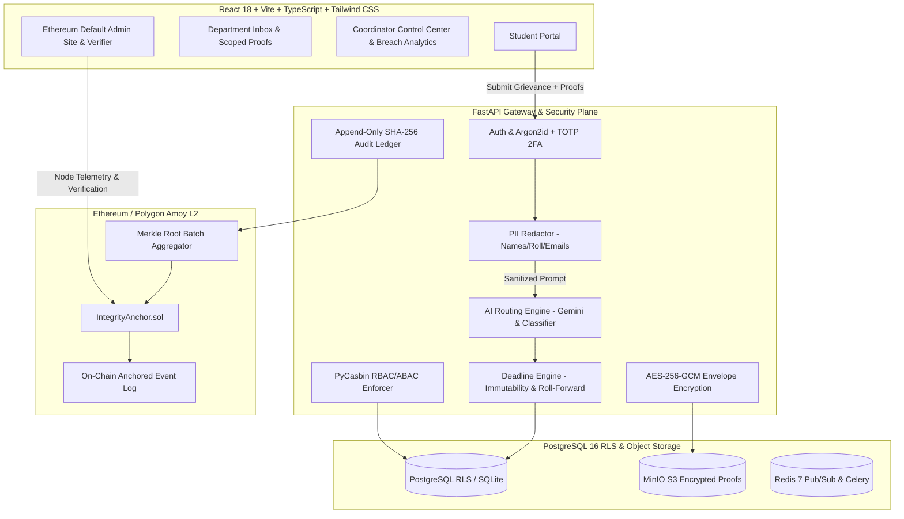

# UniResolve: Enterprise University Grievance Resolution & Blockchain Ledger

UniResolve is a production-quality, role-based university grievance resolution platform engineered with three non-negotiable architectural tenets:
1. **Security & Zero-Leakage Privacy**: Triple-layered defense (FastAPI route dependencies, PyCasbin ABAC/RBAC, PostgreSQL Row-Level Security), client-side & server-side magic-byte file filtering, AES-256-GCM envelope encryption for all proofs and reason texts, and Argon2id + TOTP 2FA for all administrative personnel.
2. **Anti-Fragmentation**: Single source of truth per grievance. While students experience an end-to-end transparent tracker, departments see strictly scoped work slices and authorized evidence. Inter-department collaboration happens inside an encrypted, SHA-256 hash-chained ledger.
3. **Deadline Integrity**: Grievance deadlines are relationally and cryptographically immutable. Enforced via database triggers preventing extension, dynamic roll-forward of early completion hours to subsequent sequential steps, and Celery Beat 1-minute automated breach escalations.

---

## 1. System Architecture



---

## 2. The Concept of the "Ethereum Default Admin Site"

> *"There is not one universal 'Ethereum Default Admin Site' for all Ethereum networks. The exact administration interface depends on the Ethereum client/framework being used. Enterprise setups may provide their own administration and monitoring tools."*

Because Ethereum testnets (Polygon Amoy, Sepolia), consortium chains (Hyperledger Besu, Quorum), and local development networks (Hardhat, Anvil, Geth) have varied RPC APIs without a built-in default graphical control panel, enterprise decentralized applications build a **dedicated Ethereum Default Admin Site**.

In **UniResolve**, this site provides:
1. **Network & RPC Node Telemetry**: Real-time status for Polygon Amoy Testnet (Chain ID `80002`), block synchronization height, and gas price tracking.
2. **Smart Contract State**: Inspects the deployed `IntegrityAnchor` contract address, owner address, and monotonic batch counters.
3. **Batch Anchoring Engine & Manual Trigger**: Real-time view of unanchored vs anchored grievance hashes with an interactive manual trigger button.
4. **On-Chain Event & Transaction Explorer**: Live table of `Anchored(bytes32 indexed merkleRoot, uint256 batchId, uint256 timestamp)` events with 1-click transaction hash copying and direct links to the Polygonscan Amoy block explorer.
5. **Cryptographic Integrity & Tamper Verifier**: Re-reads encrypted files from disk, re-computes raw SHA-256 digests, validates Merkle branch proofs, and checks the on-chain root anchor. Demonstrates `VERIFIED` on intact grievances and a live `TAMPER DETECTED` alert with exact file hash discrepancies on the pre-seeded Calculus test case.

---

## 3. Core Workflow Guarantees

### 3.1 Intake Pipeline & Envelope Encryption
- **Magic Byte Validation**: Uploaded proof files are checked by binary header magic bytes (PDF `%PDF-`, PNG `\x89PNG`, JPEG `\xff\xd8\xff`), rejecting disguised executables.
- **Envelope Encryption**: Each file receives a randomly generated 32-byte Data Encryption Key (DEK). The payload is encrypted with AES-256-GCM. The DEK is encrypted with the master key.
- **Canonical Submission Hash**:
  $$\text{submission\_hash} = \text{SHA-256}(\text{canonical\_json}(\text{title}, \text{reason}_{\text{redacted}}, \text{severity}, \text{sorted}(\text{proof\_hashes})))$$

### 3.2 Dynamic Deadline Slicing & Roll-Forward
- **Immutable Overall Window**:
  - `CRITICAL`: 48 Hours
  - `HIGH`: 5 Days
  - `NORMAL`: 7 Days
- **Sequential Roll-Forward Arithmetic**:
  When Department A finishes ahead of its scheduled deadline, the saved time ($\Delta t = \text{deadline}_A - \text{now}$) automatically rolls forward to Department B, giving Department B extra time without extending the student's overall deadline.
- **Minimum Slice Guarantee**: Every department receives $\ge 24\text{ hours}$. If a sequential chain cannot fit minimums within the overall SLA, it is flagged for Coordinator triage.

### 3.3 Inter-Department Chat Ledger
- One thread per grievance. Participants restricted to involved departments + Coordinator.
- AES-256-GCM encrypted at rest.
- Cryptographically chained:
  $$\text{entry\_hash} = \text{SHA-256}(\text{prev\_hash} \parallel \text{sender\_id} \parallel \text{issue\_id} \parallel \text{ciphertext} \parallel \text{timestamp})$$

---

## 4. Pre-Seeded Demo Accounts & Credentials

| Role | Email | Password | 2FA Policy | Assigned Department |
| :--- | :--- | :--- | :--- | :--- |
| **Student** | `student@uni.edu` | `Student123!` | Direct login | Roll: `21BCSE042` (Pseudonym: `STU-xxxx`) |
| **Department Officer** | `officer.academics@uni.edu` | `Officer123!` | Argon2id + TOTP (`123456`) | Academics / Exam Cell |
| **Department Officer** | `officer.accounts@uni.edu` | `Officer123!` | Argon2id + TOTP (`123456`) | Accounts / Fees |
| **Department Officer** | `officer.hostel@uni.edu` | `Officer123!` | Argon2id + TOTP (`123456`) | Hostel Affairs |
| **Department Officer** | `officer.transport@uni.edu` | `Officer123!` | Argon2id + TOTP (`123456`) | Transport |
| **Department Officer** | `officer.library@uni.edu` | `Officer123!` | Argon2id + TOTP (`123456`) | Library |
| **Department Officer** | `officer.it@uni.edu` | `Officer123!` | Argon2id + TOTP (`123456`) | IT Services |
| **Coordinator** | `coordinator@uni.edu` | `Coordinator123!` | Argon2id + TOTP (`123456`) | University Coordination |
| **Auditor** | `auditor@uni.edu` | `Auditor123!` | Argon2id + TOTP (`123456`) | Independent Security Auditor |
| **Admin** | `admin@uni.edu` | `Admin123!` | Argon2id + TOTP (`123456`) | System Administrator |

*Note: For convenience during demo evaluation, the UI includes a 1-click **"Switch Role"** dropdown in the top navbar and pre-fills the demo 2FA code (`123456`).*

---

## 5. Pre-Seeded Demonstration Scenarios

1. **Sequential Chain Case**: *Fee Refund Blocking Hostel Room Allotment* (Accounts $\to$ Hostel). Resolving early demonstrates dynamic roll-forward of saved hours.
2. **Parallel Work Case**: *Library Fine Discrepancy & Campus IT Portal Lockout* (Library + IT Services working concurrently).
3. **AI Low-Confidence Queue**: *Noise disturbance during reading hours* (Confidence $0.45 < 0.7$, requiring Coordinator review and manual department assignment).
4. **Already Breached Case**: *Route 14 Bus Pass Not Honored* (SLA deadline elapsed, marked `BREACHED` with red urgency pulse, non-clearable by department).
5. **Deliberately Tampered Case (Auditor Showcase)**: *End-Term Calculus Grade Re-Evaluation Submission*. Visiting the **Ethereum Default Admin Site** and running verification triggers a red `INTEGRITY VIOLATION DETECTED: File contents deviate from immutable anchor record` alert with the exact SHA-256 mismatch displayed.

---

## 6. How to Run Locally

### 6.1 Backend
```bash
cd backend
# Create and activate virtual environment
python -m venv .venv
source .venv/bin/activate  # Or on Windows: .venv\Scripts\activate

# Install dependencies
pip install -r requirements.txt

# Run the test suite (19 passing unit & integration tests)
pytest tests -v

# Start FastAPI server (pre-seeds database automatically on startup)
uvicorn app.main:app --host 127.0.0.1 --port 8000 --reload
```

### 6.2 Frontend
```bash
cd frontend
# Install dependencies
npm install

# Run development server
npm run dev

# Or build production static assets
npm run build
```

### 6.3 Docker Compose (Full Stack)
```bash
docker compose up --build
```
- Frontend UI: `http://localhost:5173`
- Backend API Docs: `http://localhost:8000/docs`
- Nginx Reverse Proxy: `http://localhost:80`
